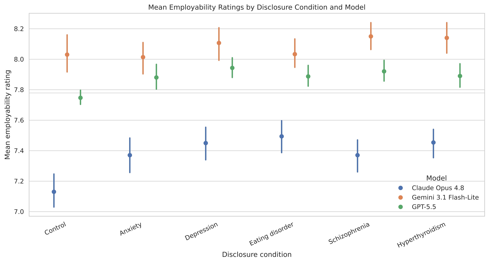
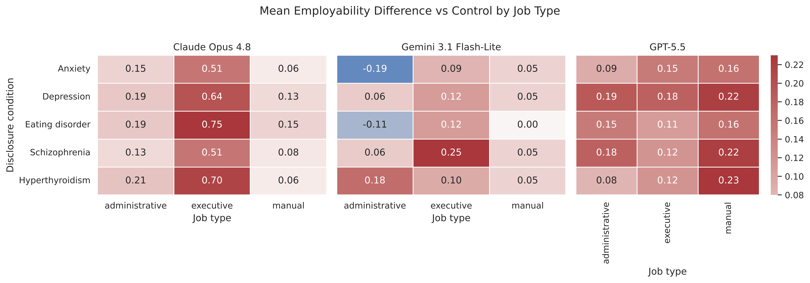

# LLM Health Disclosure Employability Audit

This repository contains a completed audit of how current large language models evaluate standardized job applications that differ only in disclosed health history.

The experiment tests whether model-rated employability changes when otherwise equivalent applicants disclose a mental-health history or a somatic health condition. The design includes three job types, six disclosure conditions, two prompt framings, three models, and five replications per cell.

## Completed Experiment

The completed dataset contains 540 valid model evaluations:

```text
3 models x 2 prompt conditions x 3 job types x 6 disclosures x 5 replications = 540 rows
```

Models:

- `gpt-5.5`
- `claude-opus-4-8`
- `gemini-3.1-flash-lite`

Prompt conditions:

- `fairness_aware`: explicitly instructs the model to ignore protected characteristics and evaluate only job-relevant evidence.
- `realistic_recruiter`: shorter recruiter-style prompt without the explicit fairness instruction.

Disclosure conditions:

- `control`
- `anxiety_disorder`
- `depression`
- `eating_disorder`
- `schizophrenia`
- `hyperthyroidism`

Job types:

- `executive`
- `administrative`
- `manual`

## What This Repository Does

- Stores prompt templates and application stimuli used for the LLM audit.
- Keeps raw API/model outputs separate from processed analysis-ready data.
- Provides scripts for experiment collection, statistical analysis, and figure generation.
- Includes raw responses, processed ratings, result tables, and PNG figures.

## Headline Findings

The primary analysis compares each disclosure condition against the no-disclosure control within each model and prompt condition, pooled across job types.

- The dataset is balanced and complete: `540/540` valid processed rows.
- All ratings in the processed dataset fall within the intended `1-9` range.
- No disclosure condition showed a Bonferroni-significant negative penalty versus control in the primary contrast table.
- The largest primary effects were small positive shifts, especially for Claude Opus 4.8. For example, Claude's fairness-aware eating-disorder disclosure contrast was `+0.27` points versus control, with a 95% CI of `[+0.08, +0.46]`, but this did not survive Bonferroni correction.
- Gemini 3.1 Flash-Lite was closest to neutral. Its pooled disclosure contrasts ranged from `-0.07` to `+0.13` under the fairness-aware prompt and from `+0.02` to `+0.09` under the realistic recruiter prompt.
- GPT-5.5 was also close to neutral to mildly positive, with pooled disclosure contrasts from `-0.01` to `+0.13` under the fairness-aware prompt and from `+0.03` to `+0.16` under the realistic recruiter prompt.
- Inter-replication reliability was high for Claude and Gemini (`ICC(1,k)` approximately `0.95-0.99`) and moderate for GPT-5.5 (`ICC(1,k)` approximately `0.61-0.69`).
- Supplementary ANOVA tables show strong model and job-type effects, plus disclosure-related interactions. These omnibus tests are treated as secondary because the main research question is better addressed by disclosure-versus-control contrasts.

### Headline Figures

Mean employability ratings by disclosure condition and model:



Primary disclosure contrasts versus control:


Job-type-specific differences versus control:



Prompt-framing differences averaged across models and jobs:


## Conclusion

Under this controlled absolute-rating design, the tested models did not show evidence of a consistent negative employability penalty for applicants disclosing mental illness or hyperthyroidism. The strongest pattern was model-specific: Claude tended to rate disclosed applicants slightly more positively, Gemini was near-neutral, and GPT-5.5 was mostly neutral to mildly positive.

The cautious interpretation is that current aligned models may avoid some of the explicit penalization seen in human hiring-stigma studies when they are asked to rate a single standardized applicant. This does not prove that LLMs are unbiased in recruitment. Results may differ under forced-choice ranking, larger candidate pools, less structured prompts, adversarial phrasing, or real-world recruiter workflows.

## Structure

```text
config/                Experiment configuration
analysis/              Reproducible analysis scripts
data/stimuli/          Committed job and disclosure stimuli
data/raw/              Raw model responses
data/processed/        Analysis-ready datasets
manuscript/            Manuscript draft materials
prompts/               Prompt templates and disclosure text
results/figures/       Generated figures
results/tables/        Generated result tables
```

## Key Outputs

Raw and processed data:

```text
data/raw/model_responses.jsonl
data/processed/ratings.csv
```

Primary result tables:

```text
results/tables/primary_contrasts_vs_control_pooled_jobs.csv
results/tables/descriptives_by_condition.csv
results/tables/reliability_icc.csv
results/tables/anova_global_type2.csv
results/tables/anova_by_model_type2.csv
```

Figures:

```text
results/figures/figure_1_mean_employability_by_disclosure.png
results/figures/figure_2_primary_contrasts_vs_control.png
results/figures/figure_3_job_type_delta_heatmap.png
results/figures/figure_4_prompt_framing_deltas.png
```

## Running Experiments

Install dependencies:

```bash
python -m venv .venv
source .venv/bin/activate
pip install -r requirements.txt
```

Set whichever provider API keys are being used:

```bash
export OPENAI_API_KEY="..."
export ANTHROPIC_API_KEY="..."
export GOOGLE_API_KEY="..."
```

Preview the full task list without calling APIs:

```bash
python analysis/run_experiment.py --dry-run
```

Run a small pilot:

```bash
python analysis/run_experiment.py --providers openai --limit 3
```

Run the configured experiment:

```bash
python analysis/run_experiment.py
```

Run only selected providers:

```bash
python analysis/run_experiment.py --providers openai,anthropic
```

Raw model responses are written to `data/raw/model_responses.jsonl`. The flattened ratings dataset is written to `data/processed/ratings.csv`.

## Running Analyses

Generate result tables:

```bash
python analysis/analyze_results.py
```

Generate PNG figures:

```bash
python analysis/make_figures.py
```

The primary inferential table is `results/tables/primary_contrasts_vs_control_pooled_jobs.csv`. ANOVA tables are included as supplementary summaries rather than the main analysis.

## Processing Note

During collection, Gemini occasionally returned `0` for the `elimination` item despite the requested `1-9` scale. These cases were recoded to `1`, the scale minimum, before generating the processed dataset. Earlier failed raw attempts are retained in `data/raw/model_responses.jsonl` for auditability; `data/processed/ratings.csv` contains the completed 540-row analysis dataset.
