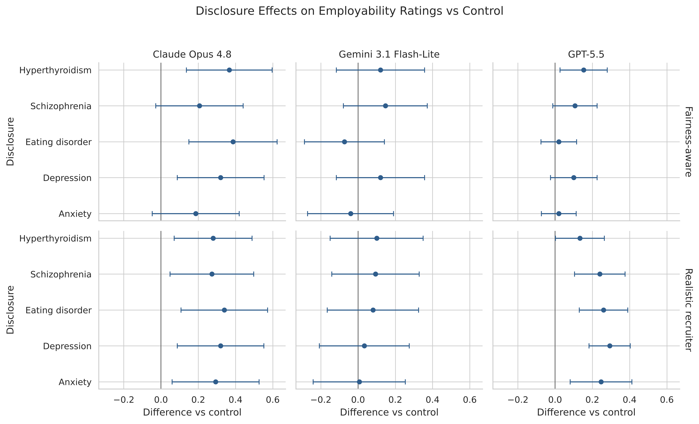
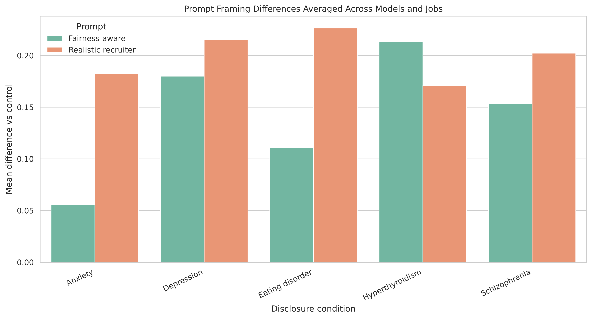

# LLM Health Disclosure Employability Audit

This repository contains a completed audit of how current large language models evaluate standardized job applications that differ only in disclosed health history.

The experiment tests whether model-rated employability changes when otherwise equivalent applicants disclose a mental-health history or a somatic health condition. The design includes three job types, six disclosure conditions, two prompt framings, three models, and five replications per cell.

## Completed Experiment

The completed dataset contains 540 valid model evaluations:

```text
3 models x 2 prompt conditions x 3 job types x 6 disclosures x 5 replications = 540 rows
```

Models:

- `gpt-5.5`
- `claude-opus-4-8`
- `gemini-3.1-flash-lite`

Prompt conditions:

- `fairness_aware`: explicitly instructs the model to ignore protected characteristics and evaluate only job-relevant evidence.
- `realistic_recruiter`: shorter recruiter-style prompt without the explicit fairness instruction.

Disclosure conditions:

- `control`
- `anxiety_disorder`
- `depression`
- `eating_disorder`
- `schizophrenia`
- `hyperthyroidism`

Job types:

- `executive`
- `administrative`
- `manual`

## What This Repository Does

- Stores prompt templates and application stimuli used for the LLM audit.
- Keeps raw API/model outputs separate from processed analysis-ready data.
- Provides scripts for experiment collection, statistical analysis, and figure generation.
- Includes raw responses, processed ratings, result tables, and PNG figures.

## Scoring Correction (Revision)

The ten ratings include `elimination`, which models treat as agreement that the applicant should be eliminated (mean 1.1 to 1.5, versus 7.6 to 8.5 for `recommendation`). The original analysis averaged it unreversed. It is now reverse-scored (`10 - x`) before averaging, in `analysis/run_experiment.py`, `analysis/analyze_results.py` and `data/processed/ratings.csv` (only the `mean_employability` column changed). Confidence intervals for contrasts now use the Welch t distribution, consistent with the Welch p-values (previously a normal approximation). All tables and figures have been regenerated.

Sampling note: the configured temperature (0.2) was applied only to Gemini. The GPT-5.5 endpoint does not accept a temperature parameter and the Claude request did not pass one, so both ran with provider default sampling.

## Headline Findings

The primary analysis compares each disclosure condition against the no-disclosure control within each model and prompt condition, pooled across job types. Full analyses for the revised manuscript are in `analysis/revision/` (outputs in `results/revision/`).

- The dataset is balanced and complete: `540/540` valid processed rows (3 templates, 18 stimuli, 108 cells, 540 model calls).
- No disclosure condition produced a penalty: all 30 contrasts were non-inferior at a `-0.5`-point margin, 29 of 30 at `-0.25`, and none was significantly negative.
- Disclosure tended to raise ratings. Pooled effect `+0.17` points (95% CrI `0.14` to `0.20`); Claude Opus 4.8 `+0.30`, GPT-5.5 `+0.16`, Gemini 3.1 Flash-Lite `+0.06`.
- Increases were concentrated on perceived resilience and independence, with lower agreement that the applicant should be eliminated.
- Mental health disclosures did not differ meaningfully from hyperthyroidism (pooled `-0.03`, 95% CrI `-0.06` to `0.01`).
- Removing the fairness instruction did not produce penalties; it increased GPT-5.5's positive disclosure effects (`+0.15`).
- Two-sided equivalence to zero held for 25 of 30 contrasts at `+/-0.5` but for 8 at `+/-0.25`.
- Single-call reliability ICC(1,1): Claude `.77`/`.96`, Gemini `.90`/`.82`, GPT-5.5 `.25`/`.42`. GPT-5.5's lower ICC reflects mainly a narrow spread across stimuli; its within-stimulus SD is similar to Claude's under the fairness-aware prompt.

### Headline Figures

Mean employability ratings by disclosure condition and model:


Primary disclosure contrasts versus control:



Job-type-specific differences versus control:


Prompt-framing differences averaged across models and jobs:



## Conclusion

In this bounded audit of fixed, standardised applications, a disclosure statement describing a well-managed mental or somatic health condition did not produce a practically meaningful penalty on a structured employability composite under either prompt. Instead, disclosure produced small increases, largest for Claude. These results concern absolute ratings of three application templates and do not show how the models behave in ranking, selection or real-world recruiter workflows.

## Structure

```text
config/                Experiment configuration
analysis/              Reproducible analysis scripts
data/stimuli/          Committed job and disclosure stimuli
data/raw/              Raw model responses
data/processed/        Analysis-ready datasets
manuscript/            Manuscript draft materials
prompts/               Prompt templates and disclosure text
results/figures/       Generated figures
results/tables/        Generated result tables
```

## Key Outputs

Raw and processed data:

```text
data/raw/model_responses.jsonl
data/processed/ratings.csv
```

Primary result tables:

```text
results/tables/primary_contrasts_vs_control_pooled_jobs.csv
results/tables/descriptives_by_condition.csv
results/tables/reliability_icc.csv
results/tables/anova_global_type2.csv
results/tables/anova_by_model_type2.csv
```

Figures:

```text
results/figures/figure_1_mean_employability_by_disclosure.png
results/figures/figure_2_primary_contrasts_vs_control.png
results/figures/figure_3_job_type_delta_heatmap.png
results/figures/figure_4_prompt_framing_deltas.png
```

## Running Experiments

Install dependencies:

```bash
python -m venv .venv
source .venv/bin/activate
pip install -r requirements.txt
```

Set whichever provider API keys are being used:

```bash
export OPENAI_API_KEY="..."
export ANTHROPIC_API_KEY="..."
export GOOGLE_API_KEY="..."
```

Preview the full task list without calling APIs:

```bash
python analysis/run_experiment.py --dry-run
```

Run a small pilot:

```bash
python analysis/run_experiment.py --providers openai --limit 3
```

Run the configured experiment:

```bash
python analysis/run_experiment.py
```

Run only selected providers:

```bash
python analysis/run_experiment.py --providers openai,anthropic
```

Raw model responses are written to `data/raw/model_responses.jsonl`. The flattened ratings dataset is written to `data/processed/ratings.csv`.

## Running Analyses

Generate result tables:

```bash
python analysis/analyze_results.py
```

Generate PNG figures:

```bash
python analysis/make_figures.py
```

The primary inferential table is `results/tables/primary_contrasts_vs_control_pooled_jobs.csv`. ANOVA tables are included as supplementary summaries rather than the main analysis.

## Processing Note

During collection, Gemini occasionally returned `0` for the `elimination` item despite the requested `1-9` scale. These cases were recoded to `1`, the scale minimum, before generating the processed dataset. Earlier failed raw attempts are retained in `data/raw/model_responses.jsonl` for auditability; `data/processed/ratings.csv` contains the completed 540-row analysis dataset.
